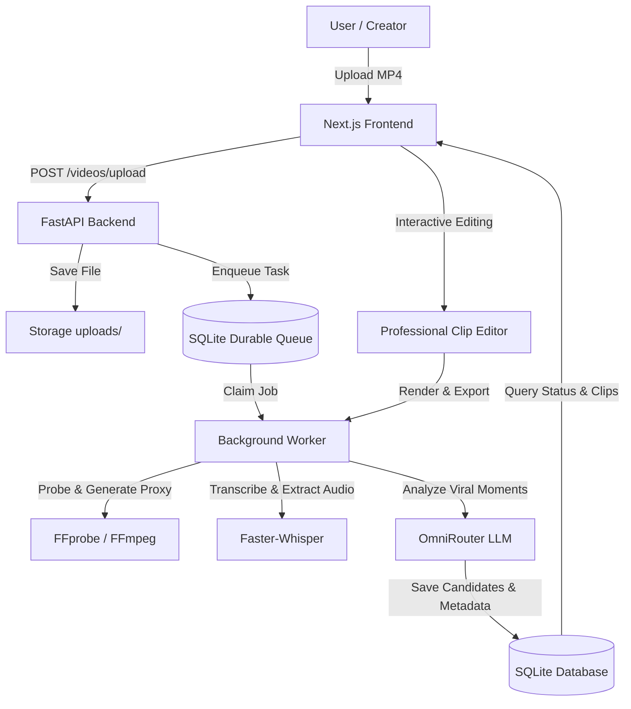

# ARCHITECTURE.md

## System Overview (Native Windows)

```text
User --> Frontend (Next.js 14 :3000) --> Backend (FastAPI :8000) --> SQLite (data/clipforge.db)
                                           │
                                           ├── Durable Job Queue (data/clipforge.db)
                                           ├── FFmpeg / FFprobe (system PATH)
                                           └── OmniRouter AI Gateway (localhost:11434)
```

## Core Components

- **Frontend** – React 18 + TypeScript SPA built with Next.js 14 App Router and Tailwind CSS.
- **Backend API** – FastAPI service exposing modular REST endpoints for uploads, clips, projects, metadata, and queue inspection.
- **Durable Background Job Queue** – SQLite-backed job queue with atomic job reservation, restart recovery, retry management, and cancellation checkpoints.
- **Database Engine** – SQLite with Write-Ahead Logging (`WAL`) mode and foreign key enforcement. Schema migrations managed by Alembic.
- **Storage Subsystem** – Local `storage/` hierarchy:
  - `storage/uploads/` — raw source media
  - `storage/proxies/` — fast 360p/720p lightweight editing proxies
  - `storage/clips/` — rendered 9:16 vertical MP4 clips
  - `storage/thumbnails/` — video frame previews & custom thumbnails
  - `storage/temp/` — audio extractions, temporary waveform data
- **AI Integration** – OmniRouter adapter for transcription analysis, hook scoring, and platform metadata generation.
- **Video Pipeline** – FFmpeg/FFprobe with smart cropping, subtitle rendering (ASS/libass), and audio normalization.
- **Social Publishing** – Official platform publishing clients for YouTube Shorts, Instagram Reels, and Facebook Reels.

## Data Flow Pipeline


